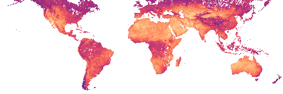

::::::: lst-landing

:::::: lst-hero

::::: lst-hero-text

# Where surface heat persists, at 30&nbsp;m

[Five years of Landsat 8 and 9 observations, reduced to the 95th-percentile land surface temperature of every 30 m pixel between 60° S and 60° N. Source Cooperative serves the tiles as cloud-optimized GeoTIFFs, and you read only the pixels you need.]{.lst-lede}

:::: lst-actions
[Open the web map](https://sensable-heat.vercel.app/){.btn .btn-primary}
[Read the quickstart](quickstart.qmd){.btn .btn-outline}
[Start the tutorial](tutorials/pergamino.qmd){.btn .btn-outline}
::::

:::::

::::: lst-hero-figure

{fig-alt="World map of 95th-percentile land surface temperature from 2021 to 2025, shaded from dark purple for cooler surfaces to pale yellow for hotter ones."}

:::: lst-ramp
::::

:::: lst-ramp-labels
Cooler

Hotter
::::

:::::

::::::

## About the dataset



## Learn more

:::::: lst-links

::::: lst-link
### [Philosophy](about/philosophy.qmd)

Why the dataset exists, and who it serves.
:::::

::::: lst-link
### [Methods](about/methods.qmd)

How the pipeline composites, normalizes, and blends the scenes.
:::::

::::: lst-link
### [Known issues](about/known-issues.qmd)

Where ASTER gaps and cloud cover leave nodata.
:::::

::::: lst-link
### [Intended use](about/intended-use.qmd)

What the values support, and the ancillary data to read them with.
:::::

::::: lst-link
### [Provenance and license](about/provenance.qmd)

The sources, the processing record, and the terms of reuse.
:::::

::::::

:::::: lst-listen

::::: lst-listen-text

## Listen

[Fit for Purpose: Building Global Heat Data for Local Planning](https://greatdataproducts.com/episodes/2026/09/wesley-heat-data/), an episode of Great Data Products.

[Nissim Lebovits and Elizabeth Wesley explain why a five-year 95th-percentile composite serves cities that have no other heat data, and why they left the emissivity gaps unfilled.]{.lst-listen-meta}

:::::

[Play the episode](https://greatdataproducts.com/episodes/2026/09/wesley-heat-data/){.btn .btn-outline}

::::::

## Get the data

A [Portolan](https://www.portolan-sdi.org/) catalog on Source Cooperative indexes the composite. Portolan adds conventions for cloud-native files to [STAC](https://stacspec.org/). Every item in it links two [cloud-optimized GeoTIFFs](https://cogeo.org/), one for temperature and one for the observation counts behind it.

::::: lst-data

Dataset page on Source Cooperative
: [source.coop/nlebovits/landsat-lst](https://source.coop/nlebovits/landsat-lst) describes the dataset and lists every file.

STAC catalog
: [catalog.json](https://data.source.coop/nlebovits/landsat-lst/catalog.json) is the entry point for `pystac`, `pystac-client`, QGIS, and STAC Browser.

Collection
: [lst-p95-2021-2025/collection.json](https://data.source.coop/nlebovits/landsat-lst/lst-p95-2021-2025/collection.json) holds the extent, the asset definitions, and the decode rule.

Web map
: [sensable-heat.vercel.app](https://sensable-heat.vercel.app/) displays every tile in the browser, with no download.

Source code
: [nlebovits/landsat-lst-pipeline](https://github.com/nlebovits/landsat-lst-pipeline) holds the pipeline, the catalog metadata, and this site.

:::::

:::::::
