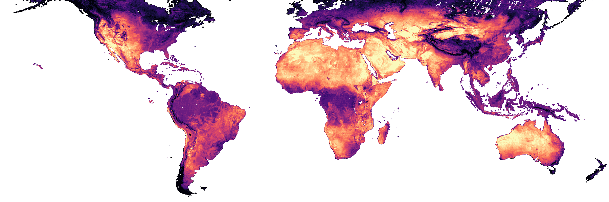

This dataset maps the 95th-percentile Landsat 8 and 9 land surface temperature from 2021 to 2025, at 30 m, for all land between 60° S and 60° N.
It is a decision support tool for cities that have no other local heat data, and it works best to compare areas within one city.
It records the temperature of the ground, roofs, and roads, not the heat that people feel, and it does not measure heat risk to people.

{fig-alt="World map of 95th-percentile land surface temperature from 2021 to 2025, shaded from dark purple for cooler surfaces to pale yellow for hotter ones."}



## Get the data

[Source Cooperative](https://source.coop/nlebovits/landsat-lst) hosts the composites as cloud-optimized GeoTIFFs, in tiles of 5° by 5°.
Each tile has two files: `lst_p95` holds the temperature in degrees Celsius, and `qa_count` holds the number of valid observations behind each pixel for each calendar month.
A cloud-optimized GeoTIFF lets you read a small area over HTTP without downloading the whole tile, and the [quickstart](quickstart.qmd) shows how to do that in Python.
To look at the data before you download it, open the [web map](https://sensable-heat.vercel.app/).

## Podcast episode


